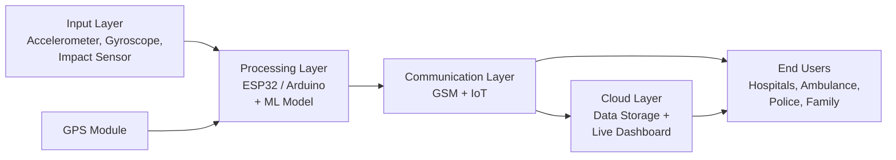

# Sensor-Based Intelligent Accident Detection & Emergency Response System

---

## Table of Contents

1. [Introduction](#1-introduction)
2. [Problem Statement](#2-problem-statement)
3. [Impact of the Problem](#3-impact-of-the-problem)
4. [Literature Survey and Base Paper Analysis](#4-literature-survey-and-base-paper-analysis)
5. [Objectives](#5-objectives)
6. [Proposed Solution Overview](#6-proposed-solution-overview)
7. [System Architecture](#7-system-architecture)
8. [Hardware Components](#8-hardware-components)
9. [Software, AI Tools and Cloud Services](#9-software-ai-tools-and-cloud-services)
10. [Working and Data Flow](#10-working-and-data-flow)
11. [Accident Detection Logic](#11-accident-detection-logic)
12. [Emergency Alert Format](#12-emergency-alert-format)
13. [Cloud Dashboard](#13-cloud-dashboard)
14. [Visual Demo (Concept Flow)](#14-visual-demo-concept-flow)
15. [Key Features and Innovation](#15-key-features-and-innovation)
16. [Expected Impact](#16-expected-impact)
17. [Budget Plan](#17-budget-plan)
18. [Challenges and Limitations](#18-challenges-and-limitations)
19. [Testing and Evaluation Plan](#19-testing-and-evaluation-plan)
20. [Future Scope](#20-future-scope)
21. [Conclusion](#21-conclusion)
22. [References](#22-references)

---

## 1. Introduction

Road accidents are a major public safety problem. According to the project's background research, India alone accounts for about 11% of global accident deaths. In many of these cases, the victim survives the impact but does not receive medical care in time, because nobody notices the accident or help is called too late.

Medical professionals describe the first hour after a serious injury as the **golden hour**. Treatment inside this window greatly improves survival chances. The gap between *accident → alert → emergency response* is therefore where lives are lost, and it is exactly the gap that technology can close.

This project builds a system that closes that gap automatically: the vehicle itself detects the crash, decides whether it is real, finds its own location and calls for help.

> **Analogy:** Think of the system as a smoke detector for a vehicle. A smoke detector does not wait for someone to notice a fire and shout. It senses the danger and raises the alarm by itself. This system does the same for road accidents.

---

## 2. Problem Statement

| Problem | Description |
|---|---|
| **High fatality rate** | Road accidents are among the leading causes of death globally (ranked 8th in the project's reference data). |
| **Response delay** | The average delay before medical help arrives is about 15 to 30 minutes. |
| **Manual reporting flaws** | Witnesses may be absent, afraid, or slow to report. On empty highways at night, nobody may report at all. |
| **No verified data** | Insurance and government bodies lack accurate, real-time accident records. |

**Who is affected?**

- **Vehicle owners:** need better safety on the road.
- **Families:** need peace of mind and instant notification.
- **Hospitals:** need early warning to prepare for incoming patients.
- **Governments:** need real-time accident data for road safety planning.

---

## 3. Impact of the Problem

- **Golden-hour loss:** survival chances drop sharply when help arrives late.
- **Rural and remote areas:** ambulances take even longer to reach the spot, and nearby witnesses are rare.
- **Insurance:** claims often lack verified accident data, which causes disputes and delays.
- **Policy:** governments lack real-time accident mapping, so dangerous road stretches stay unidentified.

---

## 4. Literature Survey and Base Paper Analysis

This section reviews published IEEE work on accident detection and alert systems, picks one paper as the **base paper**, and shows what this project adopts from it and what it adds.

### 4.1 Base paper

**Design and Development of IoT-Based Automatic Vehicle Accident Detection System**  
*Proceedings of the 2024 IEEE 9th International Conference on Adaptive Science and Technology (ICAST 2024), IEEE Computer Society.*

**Why this paper was chosen:** it is recent (2024), peer-reviewed, and uses almost the same building blocks as this project: accelerometer, GPS, GSM, Wi-Fi (IoT) and a mobile app, with a microcontroller as the controller.

**What the paper does (from its published abstract):**

- Builds a real-time, Google-Map-based and IoT-based accident tracking system.
- Helps emergency staff locate the accident and see details of the person involved.
- When the accelerometer signals an accident, the microcontroller sends an alert with location and user information to the rescue team through a mobile app.
- In testing, the module delivered the accident details by SMS and by Wi-Fi to the mobile app in **less than 11 seconds** after the accident.

**Analysis**

| Aspect | Observation |
|---|---|
| **Strengths** | Simple and low-cost architecture; two delivery paths (SMS and Wi-Fi app); Google Maps location makes it easy for responders to navigate; a measured delivery time (under 11 seconds) gives a clear benchmark. |
| **Possible gaps** | The abstract describes detection from the accelerometer signal only, and does not mention an AI-based filter for false alarms, a cloud analytics dashboard, or accident-prone-zone analysis. |
| **What this project adopts** | The sensor → GPS → GSM / Wi-Fi → app chain, the Google Maps location link in the alert, and *alert delivery time* as a key performance metric. |
| **What this project adds** | Gyroscope and impact sensing (for rollover and severity), edge-AI false-alarm filtering, a driver cancel window, a cloud dashboard for hospitals / police / fleets, and predictive analytics for accident-prone zones. |

> **Note:** the gap analysis above is based on the paper's abstract. Please read the full paper on IEEE Xplore and confirm these points before final submission. The target for this project is to match or improve the *under 11 seconds* alert time.

### 4.2 Supporting IEEE papers

| Paper | Approach | Useful lesson for this project |
|---|---|---|
| **Accident detection and reporting system using GPS, GPRS and GSM technology** (IEEE conference, Dhaka, 2012) | Uses the GPS receiver to monitor vehicle speed every second. If the speed falls below a set value, an accident is assumed, and location, time and speed are sent over GSM. | Sudden speed drop from GPS is a useful signal. A speed drop alone can also happen in normal stopping, so this project uses it only as *one input* to the ML model, together with impact and tilt data. |
| **A Smart Vehicle Alert System with Intelligent Vehicle Safety** (IEEE Xplore, 2024) | Combines accelerometer-based collision detection, eye-blink drowsiness monitoring and GPS tracking, with alerts by SMS and mobile app. Reports detection accuracy of about 95% in cities and 70% in rural areas, and a battery backup of 1 to 2 days. | Accuracy can change a lot with the road environment, so this project's tests should include different road types. Battery backup is a real design target. |

### 4.3 Related non-IEEE journal work

**An IoT-Based Automatic Vehicle Accident Detection and Visual Situation Reporting System** (Aslam et al., *Journal of Advanced Transportation*, 2024) sends sensor data to a remote server to build a visual picture of the crashed vehicles, handles false reporting, alerts the victim's family, and provides an app for eyewitnesses to report manually. It was tested in a simulated environment using a remote-controlled car.

**Lesson:** a remote-controlled car or model vehicle is a practical, safe way to test impact detection, and a manual-report app for witnesses is a good future addition.

### 4.4 Summary of the research gap

| Feature | Typical existing systems | This project |
|---|---|---|
| Impact detection | Accelerometer | Accelerometer + gyroscope + impact sensor |
| False-alarm handling | Mostly threshold-based | Threshold trigger + ML confirmation + driver cancel window |
| Where the decision is made | On device or not specified | On device (edge AI), works without internet |
| Communication | GSM or Wi-Fi / app | Dual channel: GSM + IoT |
| Monitoring | Alert to phone / app | Cloud dashboard with live map and analytics |
| Long-term benefit | Single-incident alert | Accident-prone-zone mapping for authorities |

### Key takeaway

The base paper proves that the basic chain (sensor → GPS → GSM / Wi-Fi → app) works and can deliver an alert in seconds. This project keeps that proven chain and strengthens it with smarter detection and a cloud-level view.

---

## 5. Objectives

1. **Accurate accident detection** using IoT sensors (accelerometer, gyroscope, impact sensor).
2. **Automated alerts** sent through GSM / IoT with no human action needed.
3. **Reliable communication** through a dual channel (GSM + IoT), so alerts still go out when one network is weak.
4. **Real-time monitoring** through a cloud dashboard for hospitals, police and fleet operators.
5. **AI-based false-alarm filtering** to separate real crashes from hard braking, potholes and speed breakers.

---

## 6. Proposed Solution Overview

The solution has five cooperating parts:

| Part | Role |
|---|---|
| **Sensors** | Detect sudden impact, tilt or abnormal movement. |
| **Microcontroller + AI** | Reads the sensors and decides whether the event is a real accident. |
| **GPS module** | Fetches the exact accident coordinates. |
| **GSM / IoT module** | Sends SMS / WhatsApp / call alerts and uploads data to the cloud. |
| **Cloud dashboard** | Stores and visualises incidents from many vehicles. |

> **Analogy:** The sensors are the *nerves* that feel the impact, the microcontroller is the *brain* that decides, the GPS is the *eyes* that know where we are, and the GSM module is the *voice* that calls for help.

---

## 7. System Architecture

The system is organised in four layers.



| Layer | Components | Responsibility |
|---|---|---|
| **Input** | Accelerometer, gyroscope, impact sensors | Continuously measure motion, tilt and shock. |
| **Processing** | ESP32 / Arduino with ML model | Filter data, run detection, confirm accident. |
| **Communication** | GSM module and IoT (Wi-Fi / cellular data) | Deliver alerts and upload incident data. |
| **Cloud** | AWS IoT Core / Google Cloud IoT, dashboard | Store events, show live map and analytics. |
| **End users** | Hospitals, ambulance services, police, families, government | Receive alerts and act. |

**Why this layered design works:** each layer does one job. If one part is upgraded (for example a better ML model), the other layers do not need to change.

---

## 8. Hardware Components

| Component | Purpose | Notes |
|---|---|---|
| **Accelerometer + Gyroscope** (for example an MPU6050-class IMU) | Measures acceleration (impact) and rotation (tilt, rollover). | Two units are planned for redundancy. |
| **Impact sensor** | Detects a physical shock. | Gives a second confirmation signal. |
| **GPS module** | Provides latitude, longitude and time. | Used in the alert and on the dashboard map. |
| **GSM / IoT module** | Sends SMS and calls, uploads data. | Works as the backup channel in weak networks. |
| **Microcontroller** (ESP32 / Arduino) | Runs detection logic and controls all modules. | ESP32 has built-in Wi-Fi and Bluetooth. |
| **Power + battery** | Keeps the device running during and after a crash. | A backup battery is important, as the vehicle supply may fail in a crash. |
| **Misc. components** | Wires, connectors, enclosure, buzzer or cancel button. | |

> The exact sensor models above are suggestions for a typical build. Final part numbers should be confirmed when the prototype is assembled.

---

## 9. Software, AI Tools and Cloud Services

| Tool | Use |
|---|---|
| **TensorFlow Lite / Scikit-learn** | Lightweight ML model for accident vs non-accident classification. |
| **Edge AI processing** | The model runs locally on the microcontroller, so detection works with no internet and has very low delay. |
| **Google Maps API** | Shows the accident location on a map and shares a navigation link. |
| **AWS IoT Core / Google Cloud IoT** | Scalable device connection, data storage and monitoring. |
| **Twilio / WhatsApp API** | Sends automatic alerts to emergency contacts. |
| **Arduino IDE / PlatformIO** | Firmware development for ESP32 / Arduino. |

**Why Edge AI?** If the decision were made in the cloud, a weak network could block detection itself. Running the model on the device means the *decision* never depends on connectivity. Only the *alert* does, and that is covered by the GSM backup.

---

## 10. Working and Data Flow

| Step | What happens |
|---|---|
| **1** | An accident occurs and the sensors record abnormal values. |
| **2** | The microcontroller collects and pre-processes the sensor data. |
| **3** | The AI model classifies the event as a real accident or a false alarm. |
| **4** | If confirmed, the GPS module retrieves the exact location. |
| **5** | The GSM / IoT module transmits the alerts. |
| **6** | The cloud dashboard displays the event in real time. |

The same flow matches the **Automated Emergency Response** concept used in modern connected-vehicle systems:

1. The accident happens and the system triggers an emergency call (manual or automatic).
2. Voice or data and vehicle information are sent over the network to an emergency call centre.
3. The operator checks the location and tries to contact the person.
4. If there is no reply, emergency services are sent to the spot immediately.

> **Example scenario:** A car hits a divider at night on a highway. The sensors spike, the model confirms a crash, the GPS gives the location, and within seconds a message reaches the ambulance service and the driver's family. Nobody had to pick up a phone.

---

## 11. Accident Detection Logic

Detection works in two stages so that it is both quick and accurate.

### Stage 1: Trigger (fast rule-based check)

The microcontroller continuously computes the total acceleration magnitude:

```
a_total = sqrt(ax² + ay² + az²)
```

If `a_total` crosses a configured threshold, or the gyroscope shows a sudden large tilt or rotation (rollover), the event moves to Stage 2.

### Stage 2: Confirmation (ML model)

A short window of sensor data around the trigger (for example the last 1 to 2 seconds) is given to the ML model. It classifies the event as:

- **Accident**
- **Non-accident** (hard braking, pothole, speed breaker, a dropped device)

Useful signals for the model include peak acceleration, sudden speed drop (from GPS), tilt angle, and whether the vehicle stays still after the impact.

### Driver cancel window

To limit false alarms further, a short countdown (for example 10 to 30 seconds) can let the driver cancel the alert with a button if they are fine. If there is no response, the alert is sent automatically.

### Pseudo-code

```text
loop:
    read accelerometer, gyroscope, impact sensor
    a_total = magnitude(accelerometer)

    if a_total > IMPACT_THRESHOLD or tilt > TILT_THRESHOLD:
        features = extract_features(last_window)
        result   = ml_model.predict(features)

        if result == ACCIDENT:
            start_cancel_countdown()
            if not cancelled_by_driver:
                location = gps.read()
                send_alert_gsm(location, severity)
                send_alert_iot_cloud(location, severity, sensor_snapshot)
```

> The threshold values in this report are **design parameters** to be tuned during testing. They are not final measured values.

### Common mistake to avoid

Using a single threshold alone causes many false alarms, because a pothole or hard brake can produce a spike similar to a minor crash. This is exactly why the project adds the ML confirmation stage and the cancel window.

---

## 12. Emergency Alert Format

The alert is short, so it is easy to read on a phone and fast to send over SMS. A sample alert:

```
EMERGENCY ALERT - Vehicle Accident
Location : <latitude, longitude> + Google Maps link
Time     : HH:MM:SS
Severity : Moderate / High
Driver   : <name>
Contact  : <emergency contact number>
```

The visual demo (see Section 14) uses sample values such as *Highway 101, Mile 23* and *Impact force 8.2 G*. These are **dummy values for demonstration only**, not real data.

**Recipients:** ambulance service, nearest hospital, police, and the family members stored in the device settings.

---

## 13. Cloud Dashboard

The dashboard gives a live view of all connected vehicles.

| Panel | Shows |
|---|---|
| **Incident status** | Active emergency, location, time. |
| **Response team** | Ambulance dispatched, unit ID, estimated arrival time. |
| **Vehicle data** | Impact force, speed, airbag status. |
| **Live map** | Accident location and emergency units. |
| **Analytics** | Accident history, accident-prone zones (predictive analytics). |

**Users:** hospitals, police, fleet operators, insurance companies and government road-safety teams.

---

## 14. Visual Demo (Concept Flow)

Two interactive HTML demonstrations are provided with this project. Open them in any browser.

| File | Description |
|---|---|
| `demo/a.html` | **Visual storyboard** with four animated scenes: vehicle with sensors, real-time accident detection, emergency alert sent, live cloud dashboard. |
| `demo/b.html` | **Interactive live demonstration** with Previous / Next / Reset controls, showing the ESP32, GPS and GSM chain, AI confirmation, alert notification and the command-centre dashboard. |

The four scenes follow the system story:

1. **Vehicle and sensors ready:** the system is monitoring.
2. **Accident detected:** impact is sensed and the AI confirms.
3. **Emergency alert sent:** location and details go out through GSM / IoT.
4. **Live dashboard:** responders see the incident and coordinate.

> All names, phone numbers, locations and values inside the demos are placeholder data.

---

## 15. Key Features and Innovation

| Feature | Why it matters |
|---|---|
| **Real-time detection** | Instant sensor trigger, with no waiting for a witness. |
| **Automatic alerts** | No human action is needed, which helps even if the driver is unconscious. |
| **Hybrid communication (GSM + IoT)** | If one channel fails, the other still delivers the alert. |
| **Edge AI** | Works without internet and cuts delay. |
| **AI false-alarm filtering** | Prevents wasting emergency resources on non-accidents. |
| **Predictive analytics** | Finds accident-prone roads and zones over time. |
| **Scalable design** | Adaptable for bikes, cars, buses and fleets. |

---

## 16. Expected Impact

- **Faster medical response:** help can reach the spot within minutes of the crash.
- **Reduced fatalities:** acting inside the golden hour can save more lives.
- **Improved road safety:** authorities get real-time data about dangerous zones.
- **Smart-city support:** fits government smart traffic and safety initiatives.
- **Insurance benefits:** automated, verified accident records lead to faster claims.

---

## 17. Budget Plan

The budget uses low-cost, widely available modules and the free tiers of cloud and messaging services, which keeps the whole prototype well below ₹10,000.

| Item | Qty | Unit Cost (₹) | Total (₹) |
|---|---:|---:|---:|
| Accelerometer + Gyroscope (MPU6050 type) | 2 | 250 | 500 |
| Impact / vibration sensor | 1 | 100 | 100 |
| GPS Module (NEO-6M type) | 1 | 600 | 600 |
| GSM Module (SIM800L type) | 1 | 600 | 600 |
| Microcontroller (ESP32) | 1 | 600 | 600 |
| Power + Battery (Li-ion cells, charging module, holder) | 1 | 600 | 600 |
| Misc. components (wires, board, buzzer, cancel button, enclosure) | n/a | 800 | 800 |
| SIM card + recharge | 1 | 300 | 300 |
| Cloud IoT (free tier) | n/a | 0 | 0 |
| APIs (Maps / messaging, free or trial) | n/a | 0 | 0 |
| Prototype assembly and testing | n/a | 1,500 | 1,500 |
| **Total** | | | **5,600** |

**Notes**

- Prices are approximate market prices and can vary by seller and city. Check current prices before purchase.
- Free tiers have usage limits and their terms can change. They are enough for a prototype and demo, but a real deployment would pay recurring cloud and messaging charges.
- Hardware cost falls further when units are produced in bulk.

---

## 18. Challenges and Limitations

| Challenge | Possible approach |
|---|---|
| **False positives** (potholes, hard braking) | ML confirmation stage and driver cancel window. |
| **False negatives** (a real but low-impact crash) | Tune thresholds, use multiple sensors, test on varied crash types. |
| **Poor GSM coverage** in remote areas | Dual channel; store-and-forward the alert until the network returns. |
| **GPS error** in tunnels or dense areas | Send the last known good location along with a timestamp. |
| **2G dependence of low-cost GSM modules** (for example SIM800L) | Confirm 2G coverage with the chosen network operator. A 4G module can be used if 2G is not available, at a higher cost. |
| **Power loss in a crash** | Backup battery inside the device. |
| **Training data** | Needs labelled crash and non-crash data. Real crash data is hard to collect, so public datasets and simulation may be required. |
| **Privacy** | Location and personal data must be stored securely and shared only with authorised responders. |

---

## 19. Testing and Evaluation Plan

Since this is a prototype, the following plan is proposed for validating the system.

| Test | What is checked |
|---|---|
| **Sensor calibration** | Sensor readings are correct at rest and in motion. |
| **Normal driving tests** | No alert is raised during normal driving, braking and cornering. |
| **Disturbance tests** | Potholes and speed breakers are correctly *not* flagged. |
| **Simulated impact tests** | A safe, controlled impact on a test rig or model vehicle triggers detection. |
| **Alert delivery test** | Time from detection to SMS / WhatsApp receipt is measured. |
| **Network-failure test** | The backup channel works when the primary is disabled. |
| **Dashboard test** | The event appears on the dashboard with the correct location and time. |

**Suggested metrics:** detection accuracy, false-alarm rate, missed-detection rate and alert delivery time. Results should be added here once testing is complete.

---

## 20. Future Scope

- **Predictive accident prevention:** analyse driving patterns and warn about risky behaviour.
- **Insurance automation:** instant claims from verified accident data.
- **Plug-and-play kits:** installable in both old and new vehicles.
- **Smart-city integration:** connect with smart traffic lights and autonomous vehicles.
- **Government dashboards:** real-time accident mapping for policy-making.
- **Additional sensing:** camera or airbag signal integration for better severity estimation.

---

## 21. Conclusion

The Sensor-Based Intelligent Accident Detection and Emergency Response System combines IoT sensing, edge AI and dual-channel communication to turn an accident into an immediate call for help.

- **Innovative:** AI and IoT applied to a life-saving use case.
- **Scalable:** deployable across vehicles and cities.
- **Affordable:** prototype cost of about ₹5,600, which falls further with bulk production.
- **Impactful:** saves lives, informs policy and supports smart cities.

**Vision:** a world where an accident is not the end, but the beginning of immediate help.

---

## 22. References

1. "Design and Development of IoT-Based Automatic Vehicle Accident Detection System," in *Proc. 2024 IEEE 9th Int. Conf. Adaptive Science and Technology (ICAST)*, IEEE Computer Society, 2024. *(Add the author names from IEEE Xplore.)*
2. "Accident detection and reporting system using GPS, GPRS and GSM technology," IEEE conference publication, Dhaka, Bangladesh, 18–19 May 2012. IEEE Xplore document 6317382.
3. "A Smart Vehicle Alert System with Intelligent Vehicle Safety," IEEE conference publication, IEEE Xplore, Aug. 2024. IEEE Xplore document 10627771.
4. S. Aslam, S. Islam, N. Nigar, S. A. Ajagbe, and M. O. Adigun, "An IoT-Based Automatic Vehicle Accident Detection and Visual Situation Reporting System," *Journal of Advanced Transportation*, 2024, doi: 10.1155/2024/4719669.
